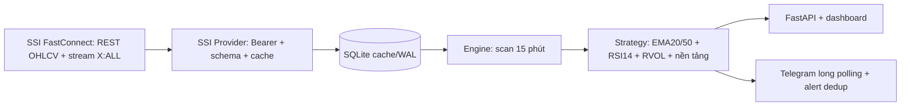

# BÁO CÁO DỰ ÁN — FINTECH BOT

## 1. Mục tiêu và phạm vi

Fintech Bot cung cấp tín hiệu Buy/Sell/Hold cho toàn bộ danh sách mã SSI trả về (HOSE, HNX, UPCOM), cho phép tra cứu từng mã, lọc kết quả, backtest 3 hoặc 6 tháng và nhận cảnh báo Telegram. Đây là hệ thống hỗ trợ học tập, không tự đặt lệnh.

## 2. Luồng dữ liệu

## 3. Công thức và điều kiện

EMA: `EMA_t = α C_t + (1−α) EMA_(t−1)`, `α = 2/(n+1)`. RSI14 dùng seed trung bình 14 thay đổi và Wilder smoothing. Hỗ trợ là `min(Low_(t−20)…Low_(t−1))`; RVOL là `Volume_t / mean(Volume_(t−20)…Volume_(t−1))`.

BUY khi EMA20 vừa cắt lên EMA50, 50 < RSI14 < 70 và RVOL ≥ 1. SELL khi close thủng hỗ trợ 20 phiên, hoặc RSI phiên trước >70 rồi quay đầu, hoặc EMA20 cắt xuống EMA50. Ưu tiên SELL; còn lại HOLD. Bộ lọc cơ bản yêu cầu ROE, tăng trưởng doanh thu và lợi nhuận cùng kỳ đều >15%; điểm mua dòng tiền yêu cầu RVOL ≥1,5 và vượt đỉnh 20 phiên.

## 4. Đánh giá

Backtest dùng open phiên kế tiếp, vốn 100 triệu, lô 100, phí 0,15% mỗi chiều, thuế bán 0,1%, trượt giá 0,1%, không bán khống. Hiển thị lợi nhuận, benchmark buy-and-hold, max drawdown, số giao dịch, win rate và vị thế mở. Kết quả phải được đọc cùng ngày chạy vì nguồn dữ liệu có thể cập nhật hoặc điều chỉnh.

## 5. Xử lý lỗi và an toàn

Provider xác thực OHLCV, giới hạn mã, retry theo 1/2/4 giây, cache tối đa 15 phút và báo rõ nguồn cũ. Không lưu token trong Git, chỉ lưu local với mode 0600. API chỉ cho host local và chặn mutation từ origin ngoài localhost. Bot chỉ nhận private chat, đăng ký tự nguyện, dedup alert theo phiên.

## 6. Demo thuyết trình

1. Mở dashboard, cho xem watchlist và một mã cổ phiếu do người xem chọn.
2. Mở `Kiểm định chiến lược`, chạy 3/6 tháng, giải thích phí và next-open.
3. Mở `Kết nối Telegram`, trình bày BotFather, `/start`, `/stock MÃ_CỔ_PHIẾU`, `/subscribe`.
4. Mở `Phương pháp đầu tư`, giải thích flow và trường hợp SSI lỗi hoặc stream mất kết nối. Hệ thống chỉ dùng SSI.
