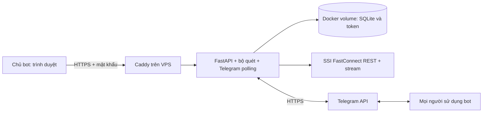

# Chạy web và Telegram bot khi Mac tắt

## Trạng thái

Đã chuẩn bị mã nguồn và cấu hình triển khai. Chưa triển khai lên VPS vì chưa có máy chủ/tài khoản hosting. Việc chạy Docker trên Mac vẫn phụ thuộc Mac; cần thực hiện các bước dưới đây trên một máy chủ luôn bật.

Kiểm tra ngày 10/09/2026: 31 bài test Python đạt, gồm đăng nhập quản trị, chặn sai nguồn và buộc cấu hình HTTPS/mật khẩu. Cấu trúc YAML được kiểm tra. Môi trường phát triển chưa có Docker nên chưa build/chạy container hay xác minh chứng chỉ HTTPS; các bước nghiệm thu trên VPS còn chờ triển khai.

## Kiến trúc



Web là trang quản trị có mật khẩu. Người dùng Telegram không cần tài khoản quản trị. Mac không nằm trong luồng vận hành sau khi triển khai.

## Chuẩn bị

- VPS Linux đang chạy, cài Docker Engine và Docker Compose plugin.
- Tên miền hoặc subdomain do bạn quản lý, DNS A trỏ đến IP VPS. Nếu có AAAA, phải trỏ đúng IPv6 VPS.
- Cho phép cổng 80/443 đến VPS; kết nối HTTPS đi ra ngoài tới SSI FastConnect và Telegram.
- Giữ đúng một container app và một worker. Không chạy cùng token trên Mac và VPS đồng thời.

## Triển khai trên VPS

Đưa gói source vào `/opt/FintechBot` trên VPS. Không tải thư mục `.venv` của Mac lên Linux. Sau đó:

```bash
cd /opt/FintechBot
cp deploy/server.env.example .env
chmod 600 .env
nano .env
```

Trong `.env`, đặt DOMAIN thành tên miền thật; đặt ADMIN_USERNAME và mật khẩu ngẫu nhiên từ 20 ký tự. Có thể tạo mật khẩu bằng `openssl rand -hex 24`. Không giữ `bot.example.com`. Không đưa `.env` vào gói chia sẻ.

```bash
cd /opt/FintechBot
docker compose up -d --build
docker compose ps
docker compose logs --tail=50 app caddy
```

Mở `https://<DOMAIN>` và đăng nhập quản trị. Caddy tự cấp chứng chỉ khi DNS/cổng 80/443 đã đúng. Trong mục Kết nối Telegram, nhập token rồi mở bot và gửi `/start`, `/subscribe`.

Nếu token đã chạy trên Mac, dừng phiên bot trên Mac trước khi kích hoạt trên VPS để tránh hai tiến trình giành `getUpdates`. Chưa tự động di chuyển danh sách người dùng cũ: hãy sao lưu/khôi phục SQLite nếu cần giữ đăng ký, hoặc yêu cầu người dùng `/subscribe` lại.

## Kiểm tra nghiệm thu

1. Kiểm tra web bằng mạng điện thoại, đăng nhập được và tải được mã cổ phiếu.
2. Hai tài khoản Telegram gửi `/start` và `/stock MÃ_CỔ_PHIẾU`; đăng ký/hủy đăng ký riêng biệt.
3. Tắt Mac; lặp lại bước 1–2. Đây là kiểm tra xác nhận hệ thống không còn phụ thuộc máy cá nhân.
4. Trên VPS chạy `docker compose restart app`; kiểm tra đăng ký và trạng thái gửi trùng còn được lưu.
5. Kiểm tra reboot VPS trong cửa sổ bảo trì; Docker phải được cấu hình tự chạy cùng hệ điều hành.

`restart: unless-stopped` tự chạy lại container khi tiến trình thoát hoặc Docker khởi động lại, trừ khi chủ động dừng. Healthcheck chỉ báo trạng thái, không tự khởi động lại container bị treo nhưng chưa thoát. Các sự cố VPS, DNS, mạng và Telegram/SSI vẫn có thể gây gián đoạn; cấu hình này không bảo đảm tuyệt đối 100% uptime.

## Dữ liệu và cập nhật

SQLite, token và đăng ký nằm trong volume `bot_data`; chứng chỉ nằm trong `caddy_data`. `docker compose down` không xóa volume mặc định. Không dùng `down -v` nếu cần giữ dữ liệu. Sau khi sửa source, chạy lại `docker compose up -d --build`. Không tăng replica vì SQLite và Telegram polling đang thiết kế cho một tiến trình.

Sao lưu trước cập nhật: dừng app ngắn hạn, sao chép toàn bộ `/app/data` ra thư mục riêng có quyền hạn chế, rồi khởi động lại. Bản sao có token và dữ liệu người dùng, không đưa vào ZIP nộp bài.

```bash
cd /opt/FintechBot
mkdir -m 700 backup-before-update
docker compose stop app
docker compose cp app:/app/data/. ./backup-before-update/
docker compose start app
```

Đổi tên thư mục backup cho mỗi lần sao lưu. Khôi phục chỉ khi app đã dừng và bảo đảm quyền sở hữu dữ liệu cho UID 10001 của container.

## Tài liệu nguồn

- Docker restart policy: https://docs.docker.com/engine/containers/start-containers-automatically/
- Docker volumes: https://docs.docker.com/engine/storage/volumes/
- Caddy HTTPS, yêu cầu DNS và cổng mạng: https://caddyserver.com/docs/automatic-https
